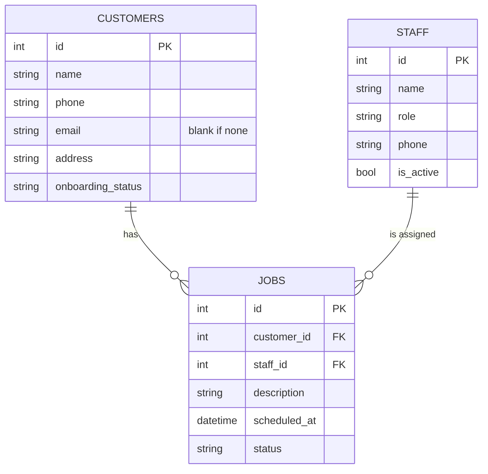
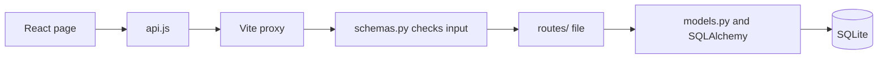

# Smarti Environmental CRM

A simple web-based CRM for a business that manages customers, appointments, fitters and maintenance engineers. Office staff use it to add customers, track their onboarding, book jobs, assign them to staff and follow their progress.

- [Getting started](#getting-started)
- [Architecture and design decisions](#architecture-and-design-decisions)
- [Development process](#development-process)

## Getting started

You need Git, Python 3.11 or newer and Node.js 22.22 or newer. There is no database to install, because SQLite comes with Python. The app creates its database file, `backend/crm.db`, the first time it starts.

Clone the repo, and open each terminal below in its root folder:

```bash
git clone https://github.com/ankathakanksha21/SmartiEnvironmental.git
```

### 1. Start the backend

```bash
cd backend
python -m venv .venv
```

On macOS or Linux, use `python3` if `python` isn't found.

Activate the virtual environment:

| Terminal | Command |
|---|---|
| Windows Command Prompt or PowerShell | `.venv\Scripts\activate` |
| Git Bash | `source .venv/Scripts/activate` |
| macOS or Linux | `source .venv/bin/activate` |

If PowerShell refuses to run the script, use Command Prompt instead.

Install the packages and start the server. Leave this terminal running.

```bash
pip install -r requirements.txt
uvicorn app.main:app --reload --reload-dir app
```

The server restarts when the code changes, and `--reload-dir app` stops it scanning `.venv`.

The API now runs on port 8000. You can try every API call from your browser at http://localhost:8000/docs.

### 2. Start the frontend

In a second terminal:

```bash
cd frontend
npm install
npm run dev
```

Open http://localhost:5173. You should see the Customers page.

If you switch git branches while `npm run dev` is running, stop it and start it again. A branch switch can make Vite restart itself and lose its link to the backend.

### 3. Add the sample data

This step is optional. It adds 4 customers, 4 staff members and 7 jobs, with dates worked out from today. In a third terminal:

```bash
cd backend
```

Activate the virtual environment as in step 1, then run:

```bash
python -m app.seed
```

Reload the page to see the data.

It only runs on a database with no customers. To start again, stop the backend, delete `backend/crm.db`, run this again and restart the backend.

### 4. Run the tests

With the virtual environment active, in the `backend` folder:

```bash
pytest
```

To check the frontend, in the `frontend` folder:

```bash
npm run lint
npm run build
```

### 5. Try the main features

**Customers**
1. Click **Add customer**, then click the button on the form without filling anything in. Each required field shows an error.
2. Fill in the form and save. The customer's page opens.
3. Under **Onboarding status**, choose another status and click **Update status**.
4. Click **Edit details**, change something and save.
5. Click **Customers** in the header. The list shows your customer with its status.

**Staff**
1. Click **Staff**, then **Add staff member**. Add a fitter and a maintenance engineer.
2. Open one, click **Edit details**, untick **Active** and save. Their status changes to Inactive, and they stay in the list.

**Jobs and appointments**

A job is a booked visit, so one record covers both the appointment and the work.

1. Click **Jobs**, then **Book a job**. Click **Book job** without filling anything in to see the errors.
2. Choose a customer and a staff member, pick a date and time in the future, add a description and save. The job's page opens with the status Pending. Inactive staff aren't offered.
3. Try booking the same staff member at the same date and time again. The form refuses it.
4. On the job's page, choose **In Progress** and click **Update status**, then do the same with **Completed**.
5. Click **Jobs**. **Upcoming** shows future jobs that aren't completed, soonest first. **All jobs** shows everything, and a past job that is still Pending has an Overdue label.
6. Open the customer and the staff member. Each page lists their jobs.

## Architecture and design decisions

### Technologies

| Part | Choice | Why |
|---|---|---|
| Backend | Python and FastAPI | FastAPI checks each request against a Python class, returns JSON and gives a `/docs` page for trying every call. |
| Database | SQLite | There is nothing to install, it needs no account, and the data is one file. One office using one app doesn't need a database server. |
| Database code | SQLAlchemy ORM | Tables are Python classes, and queries are Python calls. According to the SQLAlchemy docs, moving to PostgreSQL is mostly a new connection URL and driver. I haven't tried it. |
| Validation | Pydantic | It comes with FastAPI, and the rules sit with the fields they check. |
| Frontend | React with Vite | Each page is a small component, and the frontend only talks to the backend through its API. `react-router` gives each page its own URL. |
| Tests | pytest | Nearly all tests call the API like the browser would, and each gets its own empty database. |

### Application structure

```
backend/
  app/
    main.py        creates the app, adds the routes and error handlers
    database.py    database connection and a session for each request
    models.py      the three tables as SQLAlchemy classes
    schemas.py     request and response shapes, validation rules
    seed.py        sample data
    routes/        one file per feature: customers, staff, jobs
  tests/           one file per feature, plus test_app.py for shared parts
frontend/
  src/
    main.jsx       starts React and defines the page URLs
    api.js         every call to the backend, including the useApi hook
    useForm.js     the state every form needs
    constants.js   status and role lists
    formatDateTime.js  how dates appear on the pages
    style.css      all the styles
    components/    shared pieces such as form fields and the jobs table
    pages/         one file per page
```

Each kind of code has one home: tables in `models.py`, input rules in `schemas.py`, URLs in `routes/`, screens in `pages/`. Customers, staff and jobs each get a route file and their own pages, so a new feature adds one of each. Three tables don't need service or repository layers, so routes call the models directly.

### Database



Appointments and jobs share one table, as the brief allows. I treated an appointment as a fitter or engineer visiting a customer to do the work, so a job holds the customer, staff member, date and time, description and status. "Upcoming appointments" is a filtered list of jobs. The office books each visit once, and its date and staff member can't disagree between two records.

There is no job type column, because the assigned person's role already says whether it's fitting or maintenance.

### How the main components interact



The JSON response travels back along the same path. If the input is invalid, FastAPI stops at `schemas.py`, and the page shows each error next to its field. The route makes the database calls and checks the rules that need the database, such as whether a staff member is already booked.

### How data is created, stored, retrieved and updated

| Action | Where you do it | API call | Code in the route | SQL it runs |
|---|---|---|---|---|
| Create | Add customer form | `POST /api/customers` | `db.add(customer)`, `db.commit()` | `INSERT INTO customers ...` |
| Retrieve | Customers page | `GET /api/customers` | `db.scalars(select(Customer)...)` | `SELECT ... FROM customers ORDER BY lower(name)` |
| Update | Edit details form | `PUT /api/customers/1` | `setattr(...)`, `db.commit()` | `UPDATE customers SET ... WHERE id = ?` |

All of it is stored in `backend/crm.db`.

The ORM writes the SQL. To see it in the terminal, set `CRM_ECHO_SQL` before starting the backend, using the line for your terminal:

| Terminal | Command |
|---|---|
| PowerShell | `$env:CRM_ECHO_SQL = "1"` |
| Command Prompt | `set CRM_ECHO_SQL=1` |
| Git Bash, macOS or Linux | `export CRM_ECHO_SQL=1` |

### Alternatives I considered

| Choice | Alternative | Why I didn't use it |
|---|---|---|
| One Job table | Separate appointments and jobs tables | The date and staff member would sit in two places, and the office would enter each visit twice. |
| SQLite | PostgreSQL | Every developer would need to install it and set a password, and nothing in the brief needs a database server. |
| SQLite | Supabase | It needs an account, a secret shared outside the repo, and internet access. Its pricing page says free projects pause after a week of inactivity, so the app could be down during a review. |
| SQLAlchemy | Written SQL through `sqlite3` | It would show the SQL more plainly and needs no extra library, but moving to PostgreSQL would touch every query, the table definitions, date columns and error handling. |
| SQLAlchemy | SQLModel | In a prototype, its table models stored blank names and bad emails with no error. |
| React | Jinja2 pages from the server | These are simpler and need no Node.js. I chose React for the clean split between frontend and API, and accepted the extra install and second terminal. |
| FastAPI | Flask | Flask was smaller in a prototype (86 lines and 7 packages, against 107 and 18), but FastAPI's JSON responses, request checking and `/docs` page suit a React frontend. |
| Active flag | Deleting staff | Deleting someone would break their past jobs. |

### What I would change with more time

- **Login and roles.** Office staff would sign in, and fitters and engineers would get their own view to see their jobs and update the status from site.
- **Job durations**, to catch overlapping jobs as well as exact clashes.
- **A Cancelled status**, so a cancelled visit doesn't get marked Completed.
- **Status history**, showing who changed a status and when.
- **Search and paging** for long lists.
- **Browser tests** with a tool such as Playwright, to replace the one-off page checks.
- **Database migrations** with Alembic, so tables can change without deleting `crm.db`.
- **PostgreSQL**, if the app were hosted for several users.

### How to continue developing it

- **Add a status.** Add it to the list in `schemas.py`, the list in `constants.js`, and a badge colour in `style.css`.
- **Add a field.** Add it to the class in `models.py`, the classes in `schemas.py`, the form, the pages that show it and `seed.py`. There are no migrations yet, so delete `backend/crm.db` to rebuild the tables.
- **Add a feature.** Add a table class, schemas, a file in `routes/` included from `main.py`, pages listed in `main.jsx`, a header link in `Layout.jsx`, and a test file.

`HANDOFF.md` has the full decision log, a code guide and notes for picking the work up. Its section 2 lists the brief.

## Development process

### Prioritisation

I built everything in brief sections A to D, because the brief asks for it and the features depend on each other. Jobs need customers and staff, so those came first. If time had run short, I would have finished customers and jobs properly before adding anything else.

I left out features the brief doesn't need, such as deleting records, search, login, job durations and status history, and put the time into validation, error handling, tests and these docs. The one small extra is the Overdue label. Upcoming only shows future jobs, so a missed visit would otherwise look fine.

### Build order

Each step had its own branch and pull request, and main worked after every merge.

| Order | Branch | What it added | Why then |
|---|---|---|---|
| 1 | `design` | Decisions and build order | Prototypes settled the stack before any app code was written. |
| 2 | `project-setup` | Running API, database, React shell, tests | Every feature needs these. |
| 3 | `customers` | Customers and onboarding (brief A and B) | Jobs belong to customers. |
| 4 | `staff` | The staff list (part of brief D) | Jobs get assigned to staff. |
| 5 | `jobs` | Appointments and jobs (brief C and the rest of D) | It needs both tables above and holds the most rules. |
| 6 | `demo-and-docs` | Sample data, demo run, this README | The docs describe the finished app. |

### Challenges

- **Choosing the stack without guessing.** I built the same small feature in four stacks and compared lines of code, packages and the problems each one hit. An ORM saved little code at this size (98 lines against 107), but I chose SQLAlchemy for the easier move to PostgreSQL. The prototypes also showed that SQLModel's table models don't validate.
- **Foreign keys.** SQLite ignores them by default and stored a job for a customer that didn't exist. `database.py` now turns them on for every connection.
- **An edit form saving the wrong record.** Jumping through browser history between two edit pages kept the first customer's values in the form, and saving overwrote the second customer. `useApi` now goes back to loading when the URL changes, which removes the old form.
- **Accidentally reactivating staff.** An API edit that left out `is_active` used the add form's default and turned an inactive person active. Editing now requires the flag.
- **Double booking.** Comparing times isn't enough, because 09:30:00 and 09:30:59 look different, so the API drops seconds. Reopening a completed job could also recreate a clash, so that path checks too.
- **Tests that proved too little.** An early test still passed with its database call deleted, and the phone tests passed with a rule removed. I found these by breaking the code on purpose, and rewrote them.
- **A date typed straight through.** In Chrome, typing a date with no Tab can send a six-digit year, and the form showed a raw technical message. The API now reads the date itself and says "Enter a valid date and time."
- **The API breaking after a branch switch.** `git checkout` rewrote `vite.config.js`, and Vite's automatic restart lost the proxy. Restarting `npm run dev` fixes it, and step 2 above says so.
- **A busy reloader.** `uvicorn --reload` scanned every file in `.venv` and used about 64% of a CPU core. `--reload-dir app` cut that to about 1%.

### Known limitations

- **No login.** Anyone who can open the app can change anything. The brief doesn't require authentication.
- **No delete.** A cancelled visit can only be edited or marked Completed.
- **Exact clashes only.** Jobs have no duration, so booking someone at 09:30 and 09:45 is allowed.
- **Simultaneous bookings.** Two requests at the same moment can both pass the double-booking check, because the database doesn't enforce the rule. A partial unique index would fix it, which is more than one office needs.
- **Moving completed jobs.** A completed job can't be moved onto a time when that person has an open job, although it wouldn't create a clash.
- **Leavers keep their open jobs.** Marking someone inactive doesn't move their open jobs. Their page lists them, so the office can reassign each one.
- **Local time only.** Dates use the server's clock, which suits one site running locally.
- **Table changes need a fresh database.** There are no migrations, and the app only creates missing tables.
- **Name order.** Accented names sort after Z, because SQLite's `lower()` only handles English letters.
- **No duplicate check.** Two customers can have the same name and phone number.
- **No automated frontend tests.** I checked the pages in a real browser instead.

### How I tested it

- **Automated tests.** `pytest` runs 114 tests. They cover saving, reading and updating each record, every validation rule, the booking rules, unknown records, database failures and the sample data.
- **Frontend checks.** `npm run lint` and `npm run build` ran on every code branch.
- **Browser checks.** On each code branch I ran through the pages in a real browser using scripted clicks, including blank and invalid forms and unknown records. I also stopped the backend once to check the error message, and took screenshots at the end to check how the pages look.
- **Code review.** Each code branch had a separate review for bugs and over-complication before its pull request. That included breaking the code on purpose to check that a test failed.
- **Fresh clone.** At the end, I cloned the repo into an empty folder and ran this README's steps on Python 3.11, using Git Bash and PowerShell. The tests also pass on Python 3.12.
